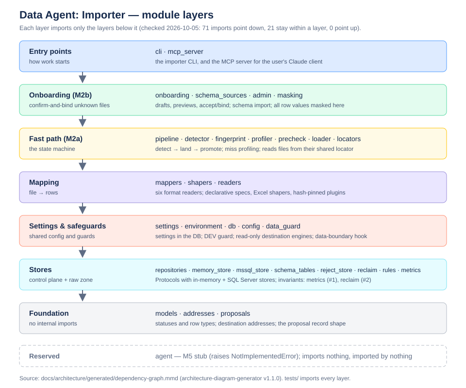
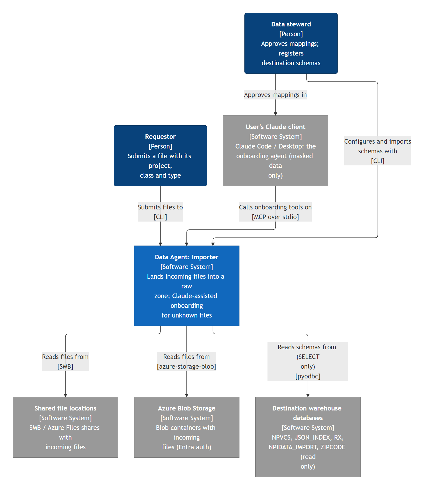
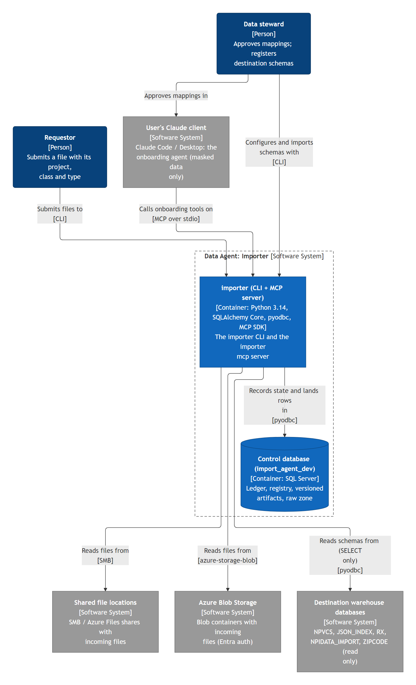
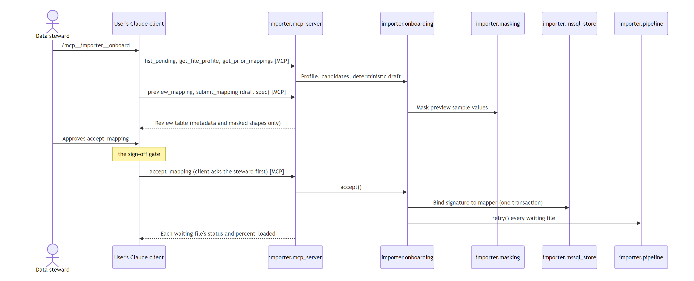

# Architecture — Data Agent: Importer

How the `importer` package (`src/importer/`) is put together, as of 2026-10-05 (M2a + M2b on `main`, commit `2d519cd`).

One Python package, 33 production modules plus `tests/`, 123 internal imports. Two entry points (the `importer` CLI and the
`importer mcp` server for the user's Claude client); everything flows down to `models`.

## The layers



**Each layer imports only the layers below it.** Checked against the generated import graph: of the 92 imports between
production modules, 71 point down, 21 stay within a layer and **none point up**. There are no import cycles.

| Layer | Modules | What it does |
|---|---|---|
| Entry points | `cli`, `mcp_server` | The `importer` command line; the MCP server whose tools and `onboard` prompt let the user's Claude client map unknown files |
| Onboarding (M2b) | `onboarding`, `schema_sources`, `admin`, `masking` | Confirm-and-bind: reuse / exact / fallback drafts, previews, submit / reject / accept; destination schema import; registration helpers. Every value derived from file rows is masked here before it can leave |
| Fast path (M2a) | `pipeline`, `detector`, `fingerprint`, `profiler`, `precheck`, `loader`, `locators` | The ledger state machine: read the file from its locator, detect the signature, profile misses, triage rows, stage, promote |
| Mapping | `mappers`, `shapers`, `readers`, `trees` | Six format readers; declarative specs (tabular / xml / tree), reviewed Excel shapers, hash-pinned plugins; nesting trees |
| Settings & safeguards | `settings`, `environment`, `db`, `config`, `data_guard` | Shared settings stored in the control database; the DEV guard; read-only destination engines; the data-boundary hook |
| Stores | `repositories`, `memory_store`, `mssql_store`, `schema_tables`, `reject_store`, `reclaim`, `rules`, `metrics` | Repository Protocols with in-memory (tests) and SQL Server implementations; raw/stage DDL; the two invariants (`metrics` #1, `reclaim` #2) |
| Foundation | `models`, `addresses`, `proposals` | Statuses and row types, destination addresses, the proposal record shape — no internal imports |
| Reserved | `agent` | M5 stub; imports nothing and nothing imports it |

"Settings & safeguards" sits above "Stores" because `settings` uses repository types and `environment` uses the
importer-owned-schema rule from `schema_tables`.

## C4 views

Generated with architecture-diagram-generator v2.2.0 (2026-10-06) from `c4/c4-facts.json` (what the code shows) plus
`c4/c4-model.json` (people, external systems, descriptions and flows; edit it and re-run `render_c4.py`). Each diagram is
in `c4/` as Mermaid (`.mmd`), SVG and PNG.

**Level 1: system context.** Who uses the importer and what it talks to.



**Level 2: containers.** One deployable (the `importer` CLI + MCP server) and the control database it owns; the destination
databases are drawn outside the system boundary because they are only read.



**Level 3: components.** All 33 modules with their imports (dense; the layer diagram above is the summary):
[c4-component-data-import-agent.png](c4/c4-component-data-import-agent.png)

**Key flows** (sequence diagrams):

- A known file lands, no model: [c4-flow-process-known-file.png](c4/c4-flow-process-known-file.png)
- An unknown file is onboarded with Claude: [c4-flow-onboard-unknown-file.png](c4/c4-flow-onboard-unknown-file.png)
- Destination schemas are registered: [c4-flow-import-destination-schemas.png](c4/c4-flow-import-destination-schemas.png)



## The two flows

- **Known file (no model):** `cli process` → `pipeline` → `locators` (read + SHA-256) → `detector` / `fingerprint` (hit) →
  `mappers` + `readers` → `precheck` → `loader` (stage → promote) → `memory_store` / `mssql_store` → ledger metrics.
- **Unknown file (onboarding):** `pipeline` quarantines it with a `profiler` proposal → the user's Claude client calls
  `mcp_server` tools → `onboarding` (masked samples and previews, drafts) → the user approves `accept_mapping` → bind in one
  transaction → `pipeline.retry` lands every waiting file. `onboarding` imports `pipeline` lazily inside `accept`; `pipeline`
  never imports `onboarding`.

## Findings

From the automated checks (`generated/summary.json`):

- No cycles, no orphan modules, no unresolved references.
- Two modules no test imports directly: `agent` (the M5 stub, expected) and `config` (only `home()`, exercised indirectly
  through the `db` tests).

From reading the code:

1. **The data boundary has one choke point.** Only `onboarding` imports `masking`, and `mcp_server` reaches row-derived data
   only through `onboarding`. It holds today, but by convention: a future MCP tool that reads a file another way would skip
   masking.
2. **`proposals` belongs with the foundation.** Both stores import `proposals.with_candidates`; `proposals` has no
   dependencies of its own (it is the proposal record's shape), so it sits in Foundation rather than Onboarding.
3. **`mssql_store.py` is the largest module (509 lines)**, holding all six SQL Server repositories (ledger, registry,
   artifacts, rejects, audit, raw zone). `onboarding.py` (402 lines) is next and has the most imports after `cli`.

## Recommendations

- Make finding 1 structural: route every row-derived MCP result through one function in `mcp_server`, or add a test that
  calls every MCP tool against a fixture and asserts no real value comes back.
- If `mssql_store.py` grows in M2c, split it per repository (finding 3). Not urgent.

## Regenerating

```bash
python <architecture-diagram-generator>/scripts/analyze_repository.py . --output <scratch folder>
```

The raw output of the 2026-10-05 run is in `generated/`: `ArchitectureReport.md` (the full report and 34-node diagram),
`dependency-graph.mmd` / `.json`, `repository-scan.json`, `summary.json`. The layer diagram (`architecture-layers.svg`, with
a PNG copy) is hand-drawn from that graph; re-check the "none point up" claim when it is regenerated.
