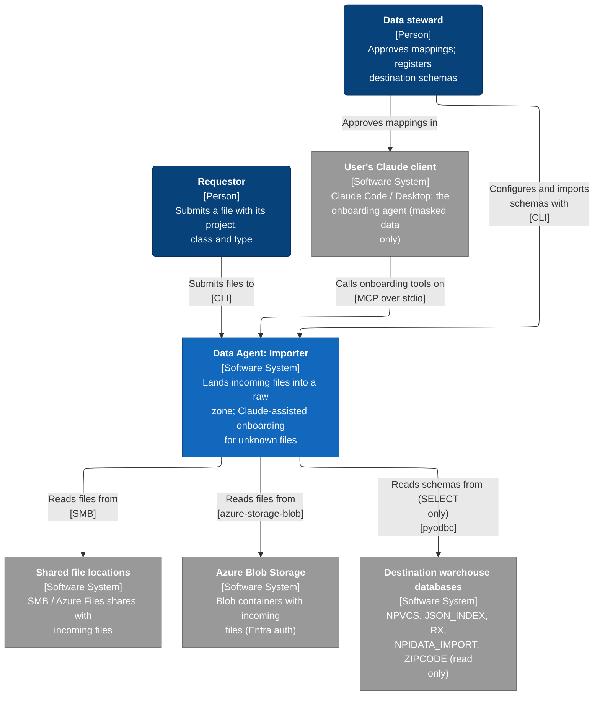
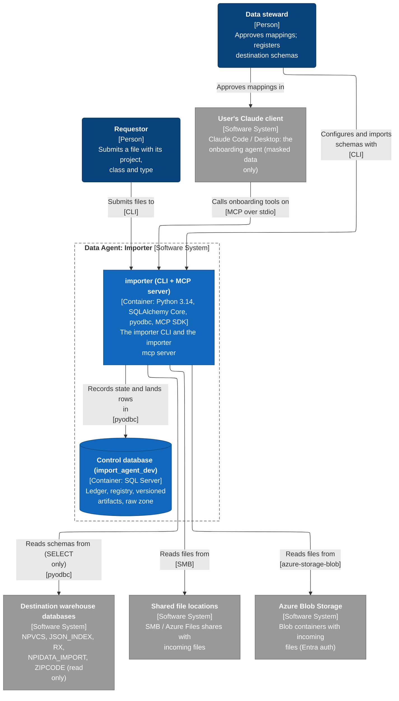
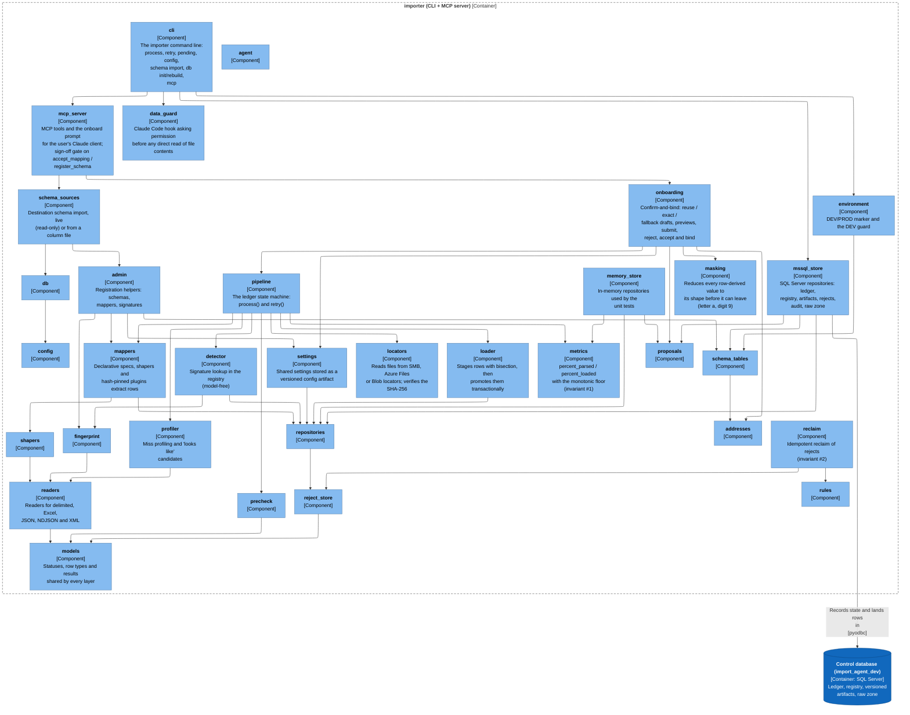
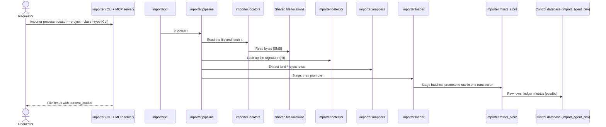
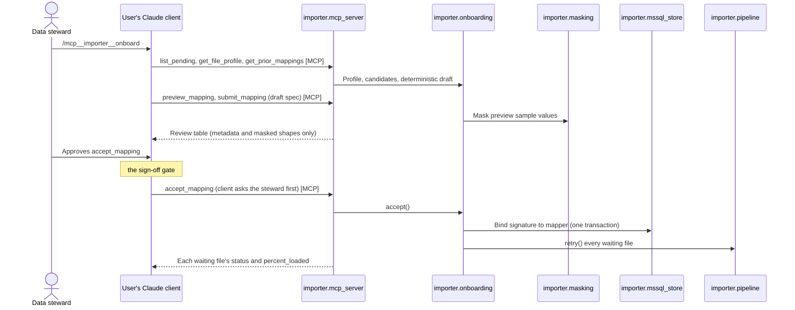
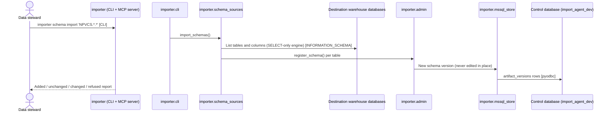

# Architecture Report

## Repository Information

**Repository Name:** DataImportAgent

**Technology Stack:**

- Python

---

## Executive Summary

DataImportAgent has 34 projects (33 production, 1 test) with 123 project references between them. The analysis found 2 concern(s).

---

[//]: # (c4:start)

## Architecture (C4 model)

Lands incoming files into a raw zone; Claude-assisted onboarding for unknown files

### Level 1: System context

### Level 2: Containers

| Container | Technology | Responsibility | Code |
|---|---|---|---|
| **importer (CLI + MCP server)** (container) | Python 3.14, SQLAlchemy Core, pyodbc, MCP SDK | The importer CLI and the importer mcp server | `.` |
| **Control database (import_agent_dev)** (data store) | SQL Server | Ledger, registry, versioned artifacts, raw zone | — |
| **Destination warehouse databases** (data store) | SQL Server (CSSNPI) | NPVCS, JSON_INDEX, RX, NPIDATA_IMPORT, ZIPCODE (read only) | — |

### Level 3: Components

For each container: the modules it is built from (when it has several), then the code structure inside them (packages or namespaces and the imports between them).

#### importer (CLI + MCP server)

> 44 of 92 dependencies are hidden because a longer path already shows them (A → C is left out when A → B → C is drawn). The full list is in the dependency graph appendix.
> 33 components: above the 20 that stay readable in one diagram.

### Key flows

How a request moves through the system, step by step.

#### A known file lands (no model)

importer process on a file whose signature is registered.

#### An unknown file is onboarded with Claude

The file was quarantined with a 'looks like' proposal; the steward maps it in a Claude session.

#### Destination schemas are registered

importer schema import 'NPVCS.*.*'; destinations are only read.

### Configuration

| Variable | Default | Used by | Declared in |
|---|---|---|---|
| `IMPORTER_DATA_GUARD` | — | importer (CLI + MCP server) | `src/importer/data_guard.py:114` |
| `IMPORTER_HOME` | — | importer (CLI + MCP server) | `src/importer/config.py:15` |

### Technology inventory

Runtime, frameworks and key libraries declared in each container's build files.

| Container | Declared |
|---|---|
| **importer (CLI + MCP server)** | `Python >=3.11`, `Python-DataEngine>=2.4`, `sqlalchemy>=2.0`, `pyodbc>=5`, `lxml>=5`, `openpyxl>=3.1`, `xlrd>=2.0`, `python-dotenv>=1.0`, `mcp>=2`, `azure-storage-blob>=12.19`, `azure-identity>=1.15` |

### C4 files

- [c4-context.mmd](c4-context.mmd)
- [c4-container.mmd](c4-container.mmd)
- [c4-component-data-import-agent.mmd](c4-component-data-import-agent.mmd)
- [c4-flow-process-known-file.mmd](c4-flow-process-known-file.mmd)
- [c4-flow-onboard-unknown-file.mmd](c4-flow-onboard-unknown-file.mmd)
- [c4-flow-import-destination-schemas.mmd](c4-flow-import-destination-schemas.mmd)
- [c4-facts.json](c4-facts.json)
- [c4-model.json](c4-model.json)

[//]: # (c4:end)

---

## Architectural Observations

### Strengths

- No circular project references.
- Projects with no project references (the core that the rest builds on): importer.addresses, importer.agent, importer.config, importer.data_guard, importer.locators, importer.masking, importer.metrics, importer.models, importer.proposals, importer.rules.

### Concerns

- Production projects that no test project references: importer.agent, importer.config.
- Test projects that reference more than one production project (check whether unit and integration tests are mixed): tests.

---

## Recommendations

- Add test projects for the untested production projects.
- Keep each test project focused on one layer, and move cross-layer tests to a dedicated integration test project.

---

## Appendix: Project Dependency Graph

Every project or module and every reference between them, tests included. The automated checks above (cycles, stray projects, untested projects) are based on this graph.

**Solutions / build roots:** none found

**Project folders:** src

```mermaid
graph TD
    tests["tests"]
    subgraph group_src["src"]
        importer_addresses["importer.addresses"]
        importer_admin["importer.admin"]
        importer_agent["importer.agent"]
        importer_cli["importer.cli"]
        importer_config["importer.config"]
        importer_data_guard["importer.data_guard"]
        importer_db["importer.db"]
        importer_detector["importer.detector"]
        importer_environment["importer.environment"]
        importer_fingerprint["importer.fingerprint"]
        importer_loader["importer.loader"]
        importer_locators["importer.locators"]
        importer_mappers["importer.mappers"]
        importer_masking["importer.masking"]
        importer_mcp_server["importer.mcp_server"]
        importer_memory_store["importer.memory_store"]
        importer_metrics["importer.metrics"]
        importer_models["importer.models"]
        importer_mssql_store["importer.mssql_store"]
        importer_onboarding["importer.onboarding"]
        importer_pipeline["importer.pipeline"]
        importer_precheck["importer.precheck"]
        importer_profiler["importer.profiler"]
        importer_proposals["importer.proposals"]
        importer_readers["importer.readers"]
        importer_reclaim["importer.reclaim"]
        importer_reject_store["importer.reject_store"]
        importer_repositories["importer.repositories"]
        importer_rules["importer.rules"]
        importer_schema_sources["importer.schema_sources"]
        importer_schema_tables["importer.schema_tables"]
        importer_settings["importer.settings"]
        importer_shapers["importer.shapers"]
    end
    importer_admin --> importer_addresses
    importer_admin --> importer_fingerprint
    importer_admin --> importer_mappers
    importer_admin --> importer_models
    importer_admin --> importer_readers
    importer_admin --> importer_repositories
    importer_admin --> importer_schema_tables
    importer_admin --> importer_settings
    importer_cli --> importer_admin
    importer_cli --> importer_config
    importer_cli --> importer_data_guard
    importer_cli --> importer_db
    importer_cli --> importer_environment
    importer_cli --> importer_mappers
    importer_cli --> importer_mcp_server
    importer_cli --> importer_models
    importer_cli --> importer_mssql_store
    importer_cli --> importer_onboarding
    importer_cli --> importer_pipeline
    importer_cli --> importer_readers
    importer_cli --> importer_schema_sources
    importer_cli --> importer_schema_tables
    importer_cli --> importer_settings
    importer_db --> importer_config
    importer_detector --> importer_fingerprint
    importer_detector --> importer_models
    importer_detector --> importer_readers
    importer_detector --> importer_repositories
    importer_environment --> importer_schema_tables
    importer_fingerprint --> importer_models
    importer_fingerprint --> importer_readers
    importer_loader --> importer_models
    importer_loader --> importer_repositories
    importer_mappers --> importer_models
    importer_mappers --> importer_readers
    importer_mappers --> importer_repositories
    importer_mappers --> importer_shapers
    importer_mcp_server --> importer_addresses
    importer_mcp_server --> importer_admin
    importer_mcp_server --> importer_locators
    importer_mcp_server --> importer_onboarding
    importer_mcp_server --> importer_schema_sources
    importer_memory_store --> importer_metrics
    importer_memory_store --> importer_models
    importer_memory_store --> importer_proposals
    importer_memory_store --> importer_reject_store
    importer_memory_store --> importer_repositories
    importer_mssql_store --> importer_addresses
    importer_mssql_store --> importer_models
    importer_mssql_store --> importer_proposals
    importer_mssql_store --> importer_repositories
    importer_mssql_store --> importer_schema_tables
    importer_onboarding --> importer_addresses
    importer_onboarding --> importer_locators
    importer_onboarding --> importer_mappers
    importer_onboarding --> importer_masking
    importer_onboarding --> importer_models
    importer_onboarding --> importer_pipeline
    importer_onboarding --> importer_profiler
    importer_onboarding --> importer_proposals
    importer_onboarding --> importer_readers
    importer_onboarding --> importer_repositories
    importer_onboarding --> importer_settings
    importer_onboarding --> importer_shapers
    importer_pipeline --> importer_detector
    importer_pipeline --> importer_loader
    importer_pipeline --> importer_locators
    importer_pipeline --> importer_mappers
    importer_pipeline --> importer_metrics
    importer_pipeline --> importer_models
    importer_pipeline --> importer_precheck
    importer_pipeline --> importer_profiler
    importer_pipeline --> importer_readers
    importer_pipeline --> importer_repositories
    importer_precheck --> importer_models
    importer_profiler --> importer_models
    importer_profiler --> importer_readers
    importer_readers --> importer_models
    importer_reclaim --> importer_models
    importer_reclaim --> importer_reject_store
    importer_reclaim --> importer_rules
    importer_reject_store --> importer_models
    importer_repositories --> importer_models
    importer_repositories --> importer_reject_store
    importer_schema_sources --> importer_addresses
    importer_schema_sources --> importer_admin
    importer_schema_sources --> importer_db
    importer_schema_sources --> importer_settings
    importer_schema_tables --> importer_addresses
    importer_settings --> importer_models
    importer_settings --> importer_repositories
    importer_shapers --> importer_readers
    tests --> importer_addresses
    tests --> importer_admin
    tests --> importer_cli
    tests --> importer_data_guard
    tests --> importer_db
    tests --> importer_detector
    tests --> importer_environment
    tests --> importer_fingerprint
    tests --> importer_loader
    tests --> importer_locators
    tests --> importer_mappers
    tests --> importer_masking
    tests --> importer_mcp_server
    tests --> importer_memory_store
    tests --> importer_metrics
    tests --> importer_models
    tests --> importer_mssql_store
    tests --> importer_onboarding
    tests --> importer_pipeline
    tests --> importer_precheck
    tests --> importer_profiler
    tests --> importer_proposals
    tests --> importer_readers
    tests --> importer_reclaim
    tests --> importer_reject_store
    tests --> importer_repositories
    tests --> importer_rules
    tests --> importer_schema_sources
    tests --> importer_schema_tables
    tests --> importer_settings
    tests --> importer_shapers
```

Full dependency graph

### Components

| Project | Ecosystem | Folder | Kind | Depends on | Used by |
|---|---|---|---|---|---|
| importer.addresses | Python | src | production | 0 | 7 |
| importer.admin | Python | src | production | 8 | 4 |
| importer.agent | Python | src | production | 0 | 0 |
| importer.cli | Python | src | production | 15 | 1 |
| importer.config | Python | src | production | 0 | 2 |
| importer.data_guard | Python | src | production | 0 | 2 |
| importer.db | Python | src | production | 1 | 3 |
| importer.detector | Python | src | production | 4 | 2 |
| importer.environment | Python | src | production | 1 | 2 |
| importer.fingerprint | Python | src | production | 2 | 3 |
| importer.loader | Python | src | production | 2 | 2 |
| importer.locators | Python | src | production | 0 | 4 |
| importer.mappers | Python | src | production | 4 | 5 |
| importer.masking | Python | src | production | 0 | 2 |
| importer.mcp_server | Python | src | production | 5 | 2 |
| importer.memory_store | Python | src | production | 5 | 1 |
| importer.metrics | Python | src | production | 0 | 3 |
| importer.models | Python | src | production | 0 | 18 |
| importer.mssql_store | Python | src | production | 5 | 2 |
| importer.onboarding | Python | src | production | 12 | 3 |
| importer.pipeline | Python | src | production | 10 | 3 |
| importer.precheck | Python | src | production | 1 | 2 |
| importer.profiler | Python | src | production | 2 | 3 |
| importer.proposals | Python | src | production | 0 | 4 |
| importer.readers | Python | src | production | 1 | 10 |
| importer.reclaim | Python | src | production | 3 | 1 |
| importer.reject_store | Python | src | production | 1 | 4 |
| importer.repositories | Python | src | production | 2 | 10 |
| importer.rules | Python | src | production | 0 | 2 |
| importer.schema_sources | Python | src | production | 4 | 3 |
| importer.schema_tables | Python | src | production | 1 | 5 |
| importer.settings | Python | src | production | 2 | 5 |
| importer.shapers | Python | src | production | 1 | 3 |
| tests | Python | - | test | 31 | 0 |

### Dependency Analysis

### importer.addresses
- no project references
- used by importer.admin, importer.mcp_server, importer.mssql_store, importer.onboarding, importer.schema_sources, importer.schema_tables, tests

### importer.admin
- depends on importer.addresses
- depends on importer.fingerprint
- depends on importer.mappers
- depends on importer.models
- depends on importer.readers
- depends on importer.repositories
- depends on importer.schema_tables
- depends on importer.settings
- used by importer.cli, importer.mcp_server, importer.schema_sources, tests

### importer.agent
- no project references

### importer.cli
- depends on importer.admin
- depends on importer.config
- depends on importer.data_guard
- depends on importer.db
- depends on importer.environment
- depends on importer.mappers
- depends on importer.mcp_server
- depends on importer.models
- depends on importer.mssql_store
- depends on importer.onboarding
- depends on importer.pipeline
- depends on importer.readers
- depends on importer.schema_sources
- depends on importer.schema_tables
- depends on importer.settings
- used by tests

### importer.config
- no project references
- used by importer.cli, importer.db

### importer.data_guard
- no project references
- used by importer.cli, tests

### importer.db
- depends on importer.config
- used by importer.cli, importer.schema_sources, tests

### importer.detector
- depends on importer.fingerprint
- depends on importer.models
- depends on importer.readers
- depends on importer.repositories
- used by importer.pipeline, tests

### importer.environment
- depends on importer.schema_tables
- used by importer.cli, tests

### importer.fingerprint
- depends on importer.models
- depends on importer.readers
- used by importer.admin, importer.detector, tests

### importer.loader
- depends on importer.models
- depends on importer.repositories
- used by importer.pipeline, tests

### importer.locators
- no project references
- used by importer.mcp_server, importer.onboarding, importer.pipeline, tests

### importer.mappers
- depends on importer.models
- depends on importer.readers
- depends on importer.repositories
- depends on importer.shapers
- used by importer.admin, importer.cli, importer.onboarding, importer.pipeline, tests

### importer.masking
- no project references
- used by importer.onboarding, tests

### importer.mcp_server
- depends on importer.addresses
- depends on importer.admin
- depends on importer.locators
- depends on importer.onboarding
- depends on importer.schema_sources
- used by importer.cli, tests

### importer.memory_store
- depends on importer.metrics
- depends on importer.models
- depends on importer.proposals
- depends on importer.reject_store
- depends on importer.repositories
- used by tests

### importer.metrics
- no project references
- used by importer.memory_store, importer.pipeline, tests

### importer.models
- no project references
- used by importer.admin, importer.cli, importer.detector, importer.fingerprint, importer.loader, importer.mappers, importer.memory_store, importer.mssql_store, importer.onboarding, importer.pipeline, importer.precheck, importer.profiler, importer.readers, importer.reclaim, importer.reject_store, importer.repositories, importer.settings, tests

### importer.mssql_store
- depends on importer.addresses
- depends on importer.models
- depends on importer.proposals
- depends on importer.repositories
- depends on importer.schema_tables
- used by importer.cli, tests

### importer.onboarding
- depends on importer.addresses
- depends on importer.locators
- depends on importer.mappers
- depends on importer.masking
- depends on importer.models
- depends on importer.pipeline
- depends on importer.profiler
- depends on importer.proposals
- depends on importer.readers
- depends on importer.repositories
- depends on importer.settings
- depends on importer.shapers
- used by importer.cli, importer.mcp_server, tests

### importer.pipeline
- depends on importer.detector
- depends on importer.loader
- depends on importer.locators
- depends on importer.mappers
- depends on importer.metrics
- depends on importer.models
- depends on importer.precheck
- depends on importer.profiler
- depends on importer.readers
- depends on importer.repositories
- used by importer.cli, importer.onboarding, tests

### importer.precheck
- depends on importer.models
- used by importer.pipeline, tests

### importer.profiler
- depends on importer.models
- depends on importer.readers
- used by importer.onboarding, importer.pipeline, tests

### importer.proposals
- no project references
- used by importer.memory_store, importer.mssql_store, importer.onboarding, tests

### importer.readers
- depends on importer.models
- used by importer.admin, importer.cli, importer.detector, importer.fingerprint, importer.mappers, importer.onboarding, importer.pipeline, importer.profiler, importer.shapers, tests

### importer.reclaim
- depends on importer.models
- depends on importer.reject_store
- depends on importer.rules
- used by tests

### importer.reject_store
- depends on importer.models
- used by importer.memory_store, importer.reclaim, importer.repositories, tests

### importer.repositories
- depends on importer.models
- depends on importer.reject_store
- used by importer.admin, importer.detector, importer.loader, importer.mappers, importer.memory_store, importer.mssql_store, importer.onboarding, importer.pipeline, importer.settings, tests

### importer.rules
- no project references
- used by importer.reclaim, tests

### importer.schema_sources
- depends on importer.addresses
- depends on importer.admin
- depends on importer.db
- depends on importer.settings
- used by importer.cli, importer.mcp_server, tests

### importer.schema_tables
- depends on importer.addresses
- used by importer.admin, importer.cli, importer.environment, importer.mssql_store, tests

### importer.settings
- depends on importer.models
- depends on importer.repositories
- used by importer.admin, importer.cli, importer.onboarding, importer.schema_sources, tests

### importer.shapers
- depends on importer.readers
- used by importer.mappers, importer.onboarding, tests

### tests
- depends on importer.addresses
- depends on importer.admin
- depends on importer.cli
- depends on importer.data_guard
- depends on importer.db
- depends on importer.detector
- depends on importer.environment
- depends on importer.fingerprint
- depends on importer.loader
- depends on importer.locators
- depends on importer.mappers
- depends on importer.masking
- depends on importer.mcp_server
- depends on importer.memory_store
- depends on importer.metrics
- depends on importer.models
- depends on importer.mssql_store
- depends on importer.onboarding
- depends on importer.pipeline
- depends on importer.precheck
- depends on importer.profiler
- depends on importer.proposals
- depends on importer.readers
- depends on importer.reclaim
- depends on importer.reject_store
- depends on importer.repositories
- depends on importer.rules
- depends on importer.schema_sources
- depends on importer.schema_tables
- depends on importer.settings
- depends on importer.shapers

---

## Generated Artifacts

- C4 diagrams: listed under Architecture (C4 model) above
- [Mermaid source](dependency-graph.mmd)
- [Dependency data (JSON)](dependency-graph.json)
- [Repository scan (JSON)](repository-scan.json)
- [Summary (JSON)](summary.json)

---

## Report Metadata

Generated On: 2026-10-06T14:28:34.573823+00:00

Generator Version: 2.2
