# Architecture Report

## Repository Information

**Repository Name:** AIDataImportAgentMCP

**Technology Stack:**

- Python

---

## Executive Summary

[//]: # (summary:start)

Lands incoming files into a raw zone; Claude-assisted onboarding for unknown files.

The model of Data Agent: Importer describes 1 container, 2 data stores, 3 external systems, 2 people, 8 relationships and 3 key flows.

[//]: # (summary:end)

The automated dependency checks found 2 concern(s).

---

[//]: # (c4:start)

## Architecture overview

Data Agent: Importer is an ELT state-machine system operating over a SQL Server ledger. It ingests incoming delimited, Excel, JSON, NDJSON, and XML files, routing known signatures through a deterministic fast path (read -> fingerprint -> map -> stage with bisection -> promote). Unrecognized or invalid files trigger a quarantined slow path where an operator-guided agent via MCP proposes reviewed, versioned mappings without modifying production code.

### Findings

- The MCP server runs over stdio with data boundaries strictly maintained by masking all preview row data into abstract shapes (src/importer/masking.py:10).
- Control plane operations strictly enforce DEV vs PROD guards before executing destructive operations such as rebuilds or schema deployment (src/importer/environment.py:40).
- Dynamic schema creation ensures landing raw and stage tables are initialized just-in-time on request rather than pre-seeded (src/importer/schema_tables.py:35).

### Recommendations

- Continue using database.env for credentials with local file protection and exclude it from version control.
- Verify that all destination warehouse connections are maintained strictly SELECT-only via dedicated read-only roles.

## Architecture (C4 model)

Lands incoming files into a raw zone; Claude-assisted onboarding for unknown files

### Diagram key

What the shapes and lines in the diagrams below mean.

| Symbol | Meaning |
|---|---|
| Dark blue rounded box | **Person** — a user or a role outside the system. |
| Blue box (Level 1) | **Software system** — the system this report describes. |
| Blue box | **Container** — an application or service that runs on its own. |
| Blue cylinder | **Data store** — a database, cache or queue. |
| Light blue box | **Component** — a module, package or namespace inside one container. |
| Pale dashed box | Used by most of the other components, drawn in another part of the same view, or shared with another container and drawn once in a shared-libraries view. |
| Grey box | **External system** — run by someone else. |
| Dashed grey outline | The system or the container the diagram is about. |
| Solid arrow | A dependency or a call, labelled with what it does and the technology it uses. |
| Dashed arrow | A dependency on a component drawn in another part of the same view. |

### Level 1: System context


Mermaid source

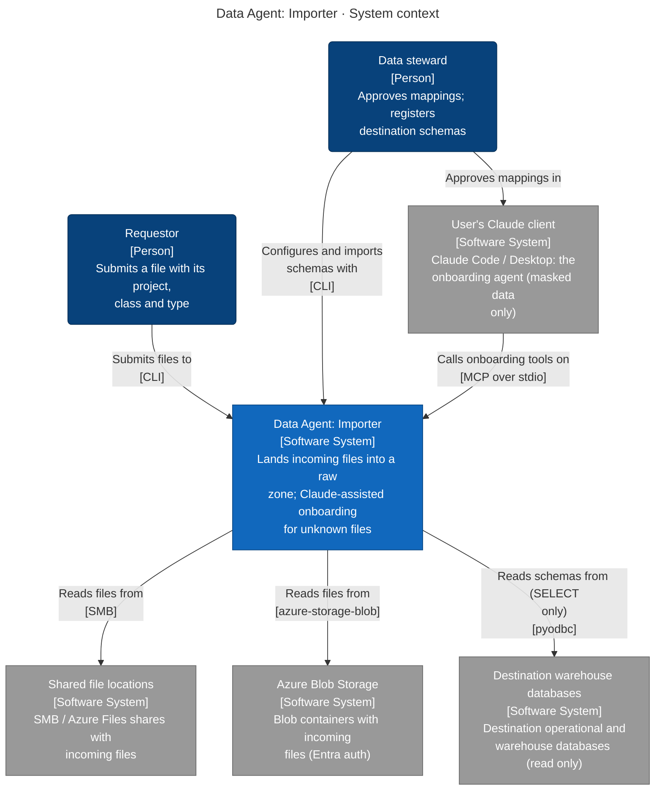

### Level 2: Containers


Mermaid source

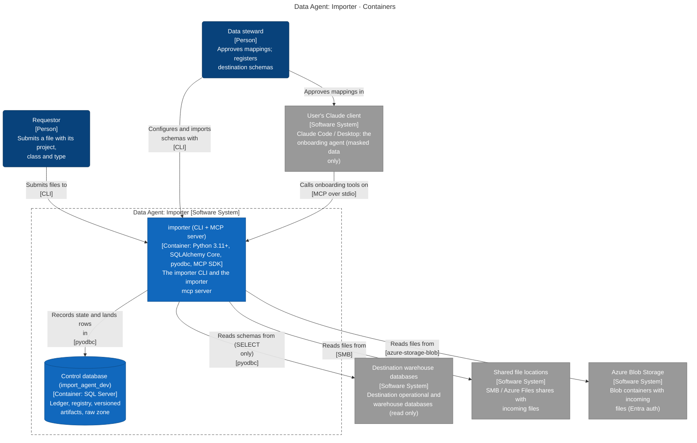

| Container | Technology | Responsibility | Code |
|---|---|---|---|
| **importer (CLI + MCP server)** (container) | Python 3.11+, SQLAlchemy Core, pyodbc, MCP SDK | The importer CLI and the importer mcp server | `.` |
| **Control database (import_agent_dev)** (data store) | SQL Server | Ledger, registry, versioned artifacts, raw zone | — |
| **Destination warehouse databases** (data store) | SQL Server | Destination operational and warehouse databases (read only) | — |

### Level 3: Components

For each container: the modules it is built from (when it has several), then the code structure inside them (packages or namespaces and the imports between them).

#### importer (CLI + MCP server) / part 1

> 50 of 101 dependencies are hidden because a longer path already shows them (A → C is left out when A → B → C is drawn). The full list is in the dependency graph appendix.
> Used by most other components, drawn in the Shared box without their incoming edges: importer.models (17).
> 35 components, drawn in 2 parts.


Mermaid source

```mermaid
---
title: "importer (CLI + MCP server) / part 1"
---
flowchart TB
    subgraph boundary["importer (CLI + MCP server) / part 1 [Container]"]
        importer_addresses["addresses<br/>[Component]<br/>Parses and validates destination<br/>database addresses<br/>[server].[db].[schema].[table]"]
        importer_agent["agent<br/>[Component]<br/>Agent stub for slow-path<br/>resolution workflows"]
        importer_config["config<br/>[Component]<br/>Configuration loader for<br/>database.env, directory paths, and<br/>settings"]
        importer_data_guard["data_guard<br/>[Component]<br/>Claude Code hook asking permission<br/>before any direct read of file<br/>contents"]
        importer_locators["locators<br/>[Component]<br/>Reads files from SMB, Azure Files<br/>or Blob locators; verifies the<br/>SHA-256"]
        importer_masking["masking<br/>[Component]<br/>Reduces every row-derived value to<br/>its shape before it can leave<br/>(letter a, digit 9)"]
        importer_metrics["metrics<br/>[Component]<br/>percent_parsed / percent_loaded<br/>with the monotonic floor<br/>(invariant #1)"]
        importer_precheck["precheck<br/>[Component]<br/>Row-level validation and schema<br/>conformity verification prior to<br/>staging"]
        importer_proposals["proposals<br/>[Component]<br/>Candidate generation, proposal<br/>schemas, and review records"]
        importer_readers["readers<br/>[Component]<br/>Readers for delimited, Excel,<br/>JSON, NDJSON and XML"]
        importer_reject_store["reject_store<br/>[Component]<br/>Rejection storage protocol and in-<br/>memory test reference"]
        importer_rules["rules<br/>[Component]<br/>Validation and transformation<br/>rules for row parsing and reclaim"]
        importer_db["db<br/>[Component]<br/>SQLAlchemy engine management and<br/>read-only destination connection<br/>factory"]
        importer_reclaim["reclaim<br/>[Component]<br/>Idempotent reclaim of rejects<br/>(invariant #2)"]
        importer_repositories["repositories<br/>[Component]<br/>Repository protocols for<br/>transactions, ledger, and<br/>artifacts"]
        importer_schema_tables["schema_tables<br/>[Component]<br/>Dynamic table creation and<br/>management for raw and stage<br/>tables"]
        importer_shapers["shapers<br/>[Component]<br/>Structural transforms such as<br/>Excel crosstab unpivot and anchor<br/>headers"]
        importer_trees["trees<br/>[Component]<br/>Nesting tree structures for<br/>complex hierarchical formats"]
        importer_environment["environment<br/>[Component]<br/>DEV/PROD marker and the DEV guard"]
        subgraph shared["Shared"]
            importer_models["models<br/>[Component]<br/>Statuses, row types and results<br/>shared by every layer"]
        end
    end
    importer_db --> importer_config
    importer_reclaim --> importer_reject_store
    importer_reclaim --> importer_rules
    importer_repositories --> importer_reject_store
    importer_schema_tables --> importer_addresses
    importer_shapers --> importer_readers
    importer_trees --> importer_readers
    importer_environment --> importer_schema_tables
    importer_agent ~~~ importer_proposals
    importer_data_guard ~~~ importer_db
    importer_locators ~~~ importer_reclaim
    importer_masking ~~~ importer_repositories
    importer_metrics ~~~ importer_shapers
    importer_precheck ~~~ importer_trees
    importer_proposals ~~~ importer_environment
    db_sql_server[("Control database (import_agent_dev)<br/>[Container: SQL Server]<br/>Ledger, registry, versioned<br/>artifacts, raw zone")]
    importer_db -->|"Records state and lands rows<br/>in<br/>[pyodbc]"| db_sql_server
    requestor("Requestor<br/>[Person]<br/>Submits a file with its project,<br/>class and type")
    requestor -->|"Submits files to<br/>[CLI]"| boundary
    steward("Data steward<br/>[Person]<br/>Approves mappings; registers<br/>destination schemas")
    steward -->|"Configures and imports<br/>schemas with<br/>[CLI]"| boundary
    claude_client["User's Claude client<br/>[Software System]<br/>Claude Code / Desktop: the<br/>onboarding agent (masked data<br/>only)"]
    claude_client -->|"Calls onboarding tools on<br/>[MCP over stdio]"| boundary
    file_shares["Shared file locations<br/>[Software System]<br/>SMB / Azure Files shares with<br/>incoming files"]
    boundary -->|"Reads files from<br/>[SMB]"| file_shares
    azure_blob["Azure Blob Storage<br/>[Software System]<br/>Blob containers with incoming<br/>files (Entra auth)"]
    boundary -->|"Reads files from<br/>[azure-storage-blob]"| azure_blob
    destination_dbs["Destination warehouse databases<br/>[Software System]<br/>Destination operational and<br/>warehouse databases (read only)"]
    boundary -->|"Reads schemas from (SELECT<br/>only)<br/>[pyodbc]"| destination_dbs
    classDef person fill:#08427b,stroke:#052e56,color:#ffffff
    classDef container fill:#1168bd,stroke:#0b4884,color:#ffffff
    classDef system fill:#1168bd,stroke:#0b4884,color:#ffffff
    classDef component fill:#85bbf0,stroke:#5d82a8,color:#000000
    classDef external fill:#999999,stroke:#6b6b6b,color:#ffffff
    classDef shared fill:#dbe9f6,stroke:#5d82a8,color:#000000,stroke-dasharray:4 3
    class importer_addresses,importer_agent,importer_config,importer_data_guard,importer_locators,importer_masking,importer_metrics,importer_precheck,importer_proposals,importer_readers,importer_reject_store,importer_rules,importer_db,importer_reclaim,importer_repositories,importer_schema_tables,importer_shapers,importer_trees,importer_environment component
    class importer_models shared
    class db_sql_server container
    class requestor,steward person
    class claude_client,file_shares,azure_blob,destination_dbs external
    style boundary fill:none,stroke:#444444,stroke-dasharray:6 4
```

#### importer (CLI + MCP server) / part 2


Mermaid source

```mermaid
---
title: "importer (CLI + MCP server) / part 2"
---
flowchart TB
    subgraph boundary["importer (CLI + MCP server) / part 2 [Container]"]
        importer_fingerprint["fingerprint<br/>[Component]<br/>Computes file structural<br/>fingerprints and physical<br/>signatures"]
        importer_loader["loader<br/>[Component]<br/>Stages rows with bisection, then<br/>promotes them transactionally"]
        importer_mappers["mappers<br/>[Component]<br/>Declarative specs, shapers and<br/>hash-pinned plugins extract rows"]
        importer_memory_store["memory_store<br/>[Component]<br/>In-memory repositories used by the<br/>unit tests"]
        importer_mssql_store["mssql_store<br/>[Component]<br/>SQL Server repositories: ledger,<br/>registry, artifacts, rejects,<br/>audit, raw zone"]
        importer_profiler["profiler<br/>[Component]<br/>Miss profiling and 'looks like'<br/>candidates"]
        importer_settings["settings<br/>[Component]<br/>Shared settings stored as a<br/>versioned config artifact"]
        importer_admin["admin<br/>[Component]<br/>Registration helpers: schemas,<br/>mappers, signatures"]
        importer_detector["detector<br/>[Component]<br/>Signature lookup in the registry<br/>(model-free)"]
        importer_setup_wizard["setup_wizard<br/>[Component]<br/>Interactive and scriptable first-<br/>run standup wizard; creates<br/>database and deploys control<br/>schema"]
        importer_pipeline["pipeline<br/>[Component]<br/>The ledger state machine:<br/>process() and retry()"]
        importer_schema_sources["schema_sources<br/>[Component]<br/>Destination schema import, live<br/>(read-only) or from a column file"]
        importer_onboarding["onboarding<br/>[Component]<br/>Confirm-and-bind: reuse / exact /<br/>fallback drafts, previews, submit,<br/>reject, accept and bind"]
        importer_mcp_server["mcp_server<br/>[Component]<br/>MCP tools and the onboard prompt<br/>for the user's Claude client;<br/>sign-off gate on accept_mapping /<br/>register_schema"]
        importer_cli["cli<br/>[Component]<br/>The importer command line:<br/>process, retry, pending, config,<br/>schema import, db init/rebuild,<br/>mcp"]
    end
    importer_trees["trees<br/>[Component, in part 1]"]
    importer_repositories["repositories<br/>[Component, in part 1]"]
    importer_shapers["shapers<br/>[Component, in part 1]"]
    importer_metrics["metrics<br/>[Component, in part 1]"]
    importer_proposals["proposals<br/>[Component, in part 1]"]
    importer_schema_tables["schema_tables<br/>[Component, in part 1]"]
    importer_db["db<br/>[Component, in part 1]"]
    importer_environment["environment<br/>[Component, in part 1]"]
    importer_locators["locators<br/>[Component, in part 1]"]
    importer_precheck["precheck<br/>[Component, in part 1]"]
    importer_addresses["addresses<br/>[Component, in part 1]"]
    importer_masking["masking<br/>[Component, in part 1]"]
    importer_data_guard["data_guard<br/>[Component, in part 1]"]
    importer_fingerprint -.-> importer_trees
    importer_loader -.-> importer_repositories
    importer_mappers -.-> importer_repositories
    importer_mappers -.-> importer_shapers
    importer_memory_store -.-> importer_metrics
    importer_memory_store -.-> importer_proposals
    importer_memory_store -.-> importer_repositories
    importer_mssql_store -.-> importer_proposals
    importer_mssql_store -.-> importer_repositories
    importer_mssql_store -.-> importer_schema_tables
    importer_profiler -.-> importer_trees
    importer_settings -.-> importer_repositories
    importer_admin --> importer_fingerprint
    importer_admin --> importer_mappers
    importer_admin -.-> importer_schema_tables
    importer_admin --> importer_settings
    importer_detector --> importer_fingerprint
    importer_detector -.-> importer_repositories
    importer_setup_wizard -.-> importer_db
    importer_setup_wizard -.-> importer_environment
    importer_pipeline --> importer_detector
    importer_pipeline --> importer_loader
    importer_pipeline -.-> importer_locators
    importer_pipeline --> importer_mappers
    importer_pipeline -.-> importer_metrics
    importer_pipeline -.-> importer_precheck
    importer_pipeline --> importer_profiler
    importer_schema_sources --> importer_admin
    importer_schema_sources -.-> importer_db
    importer_onboarding -.-> importer_addresses
    importer_onboarding -.-> importer_masking
    importer_onboarding --> importer_pipeline
    importer_onboarding -.-> importer_proposals
    importer_onboarding --> importer_settings
    importer_mcp_server --> importer_onboarding
    importer_mcp_server --> importer_schema_sources
    importer_cli -.-> importer_data_guard
    importer_cli --> importer_mcp_server
    importer_cli --> importer_mssql_store
    importer_cli --> importer_setup_wizard
    db_sql_server[("Control database (import_agent_dev)<br/>[Container: SQL Server]<br/>Ledger, registry, versioned<br/>artifacts, raw zone")]
    importer_mssql_store -->|"Records state and lands rows<br/>in<br/>[pyodbc]"| db_sql_server
    requestor("Requestor<br/>[Person]<br/>Submits a file with its project,<br/>class and type")
    requestor -->|"Submits files to<br/>[CLI]"| boundary
    steward("Data steward<br/>[Person]<br/>Approves mappings; registers<br/>destination schemas")
    steward -->|"Configures and imports<br/>schemas with<br/>[CLI]"| boundary
    claude_client["User's Claude client<br/>[Software System]<br/>Claude Code / Desktop: the<br/>onboarding agent (masked data<br/>only)"]
    claude_client -->|"Calls onboarding tools on<br/>[MCP over stdio]"| boundary
    file_shares["Shared file locations<br/>[Software System]<br/>SMB / Azure Files shares with<br/>incoming files"]
    boundary -->|"Reads files from<br/>[SMB]"| file_shares
    azure_blob["Azure Blob Storage<br/>[Software System]<br/>Blob containers with incoming<br/>files (Entra auth)"]
    boundary -->|"Reads files from<br/>[azure-storage-blob]"| azure_blob
    destination_dbs["Destination warehouse databases<br/>[Software System]<br/>Destination operational and<br/>warehouse databases (read only)"]
    boundary -->|"Reads schemas from (SELECT<br/>only)<br/>[pyodbc]"| destination_dbs
    classDef person fill:#08427b,stroke:#052e56,color:#ffffff
    classDef container fill:#1168bd,stroke:#0b4884,color:#ffffff
    classDef system fill:#1168bd,stroke:#0b4884,color:#ffffff
    classDef component fill:#85bbf0,stroke:#5d82a8,color:#000000
    classDef external fill:#999999,stroke:#6b6b6b,color:#ffffff
    classDef shared fill:#dbe9f6,stroke:#5d82a8,color:#000000,stroke-dasharray:4 3
    class importer_fingerprint,importer_loader,importer_mappers,importer_memory_store,importer_mssql_store,importer_profiler,importer_settings,importer_admin,importer_detector,importer_setup_wizard,importer_pipeline,importer_schema_sources,importer_onboarding,importer_mcp_server,importer_cli component
    class importer_trees,importer_repositories,importer_shapers,importer_metrics,importer_proposals,importer_schema_tables,importer_db,importer_environment,importer_locators,importer_precheck,importer_addresses,importer_masking,importer_data_guard shared
    class db_sql_server container
    class requestor,steward person
    class claude_client,file_shares,azure_blob,destination_dbs external
    style boundary fill:none,stroke:#444444,stroke-dasharray:6 4
```

### Level 4: Code

The classes and interfaces of the key components: inheritance, implemented interfaces, dependencies inside the component and public methods. Boxes marked external live in another component.

#### importer (CLI + MCP server) · importer.mssql_store

SQL Server persistent implementation of ledger, registry, and raw stores

> Sources: MssqlStore → `src/importer/mssql_store.py:506`, MssqlTx → `src/importer/mssql_store.py:495`, MssqlLedger → `src/importer/mssql_store.py:108`, MssqlRawZone → `src/importer/mssql_store.py:407`, MssqlRegistry → `src/importer/mssql_store.py:191`, MssqlRejectStore → `src/importer/mssql_store.py:355`
> Not drawn: 84 more types (Address, AddressError, ArtifactRepository, ArtifactRow, ArtifactType, AuditLog, Candidate, CheckedRow, Column, ConcurrentTransition, …)


Mermaid source

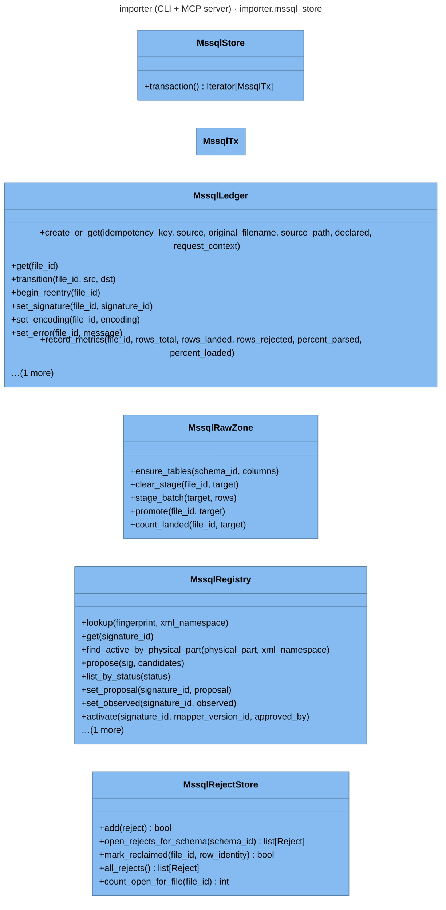

#### importer (CLI + MCP server) · importer.memory_store

In-memory test store mirroring all transactional protocols with simulated fault injection

> Sources: MemoryStore → `src/importer/memory_store.py:330`, MemoryTx → `src/importer/memory_store.py:320`, MemoryLedger → `src/importer/memory_store.py:65`, MemoryRawZone → `src/importer/memory_store.py:264`, RawFault → `src/importer/memory_store.py:39`
> Not drawn: 85 more types (Address, AddressError, ArtifactRepository, ArtifactRow, ArtifactType, AuditLog, Candidate, CheckedRow, Column, ConcurrentTransition, …)


Mermaid source

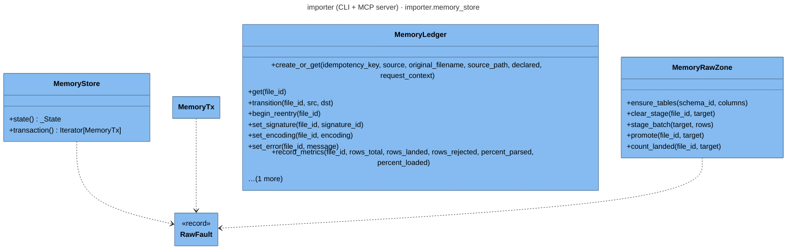

### Key flows

How a request moves through the system, step by step.

#### A known file lands (no model)

importer process on a file whose signature is registered.

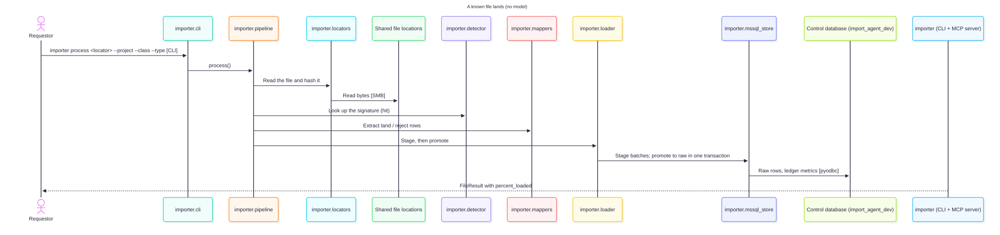

Mermaid source

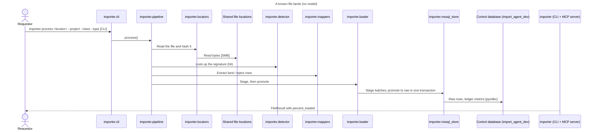

#### An unknown file is onboarded with Claude

The file was quarantined with a 'looks like' proposal; the steward maps it in a Claude session.

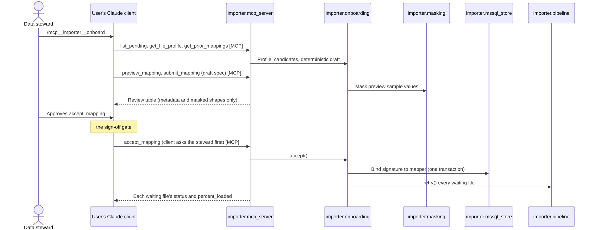

Mermaid source

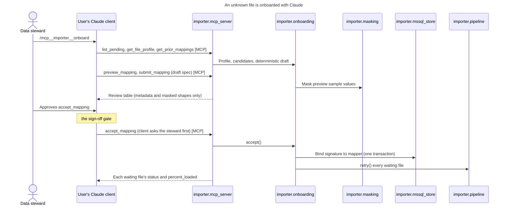

#### Destination schemas are registered

importer schema import "WAREHOUSE.*.*"; destinations are only read.

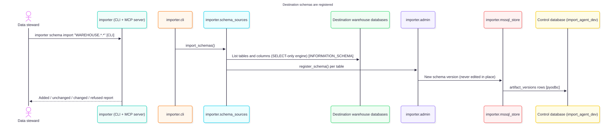

Mermaid source

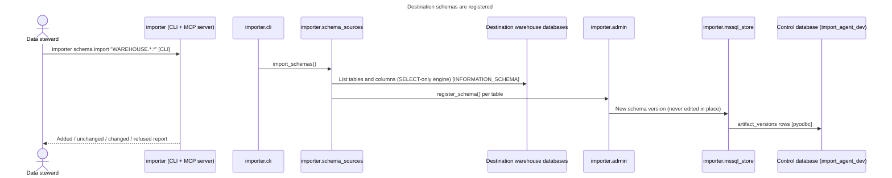

### Deployment

#### Container images

| Dockerfile | Build stages | Runtime image | Exposes | Starts with |
|---|---|---|---|---|
| `Dockerfile` | 1 | `python:3.12-slim-bookworm` | — | `["importer", "mcp"]` |

#### CI and hosting files

- **GitHub Actions**: `.github/workflows/ci.yml`, `.github/workflows/release.yml`

### Configuration

Config files: `.env.example`

| Variable | Default | Used by | Declared in |
|---|---|---|---|
| `IMPORTER_DATABASE_URL` | — | importer (CLI + MCP server) | `src/importer/db.py:186` |
| `IMPORTER_DATA_GUARD` | — | importer (CLI + MCP server) | `src/importer/data_guard.py:120` |
| `IMPORTER_DATA_LOCATIONS` | — | importer (CLI + MCP server) | `src/importer/data_guard.py:32` |
| `IMPORTER_GUARDED_SCHEMAS` | — | importer (CLI + MCP server) | `src/importer/data_guard.py:45` |
| `IMPORTER_HOME` | — | importer (CLI + MCP server) | `src/importer/config.py:15` |
| `IMPORTER_PASSWORD` | — | importer (CLI + MCP server) | `src/importer/db.py:91` |
| `MSSQL_ODBC_DRIVER` | — | importer (CLI + MCP server) | `src/importer/db.py:114` |

### Technology inventory

Runtime, frameworks and key libraries declared in each container's build files.

| Container | Declared |
|---|---|
| **importer (CLI + MCP server)** | `Python >=3.11`, `sqlalchemy>=2.0`, `pyodbc>=5`, `lxml>=5`, `openpyxl>=3.1`, `xlrd>=2.0`, `python-dotenv>=1.0`, `mcp>=2`, `azure-storage-blob>=12.19`, `azure-identity>=1.15` |

### C4 files

- [c4-context.mmd](c4-context.mmd)
- [c4-container.mmd](c4-container.mmd)
- [c4-component-data-import-agent-part1.mmd](c4-component-data-import-agent-part1.mmd)
- [c4-component-data-import-agent-part2.mmd](c4-component-data-import-agent-part2.mmd)
- [c4-flow-process-known-file.mmd](c4-flow-process-known-file.mmd)
- [c4-flow-onboard-unknown-file.mmd](c4-flow-onboard-unknown-file.mmd)
- [c4-flow-import-destination-schemas.mmd](c4-flow-import-destination-schemas.mmd)
- [c4-code-data-import-agent-importer-mssql-store.mmd](c4-code-data-import-agent-importer-mssql-store.mmd)
- [c4-code-data-import-agent-importer-memory-store.mmd](c4-code-data-import-agent-importer-memory-store.mmd)
- [c4-facts.json](c4-facts.json)
- [c4-model.json](c4-model.json)

[//]: # (c4:end)

---

## Architectural Observations

### Strengths

[//]: # (strengths:start)

- Every container, data store and external system found in the code is in the model.
- Every container says what it is responsible for.
- Every component says what it does.
- The model names who the system is for: Requestor and Data steward.
- 3 key flows are written down end to end: A known file lands (no model), An unknown file is onboarded with Claude and Destination schemas are registered.
- Every container and external system points at the code that proves it.
- No circular project references.

[//]: # (strengths:end)

### Concerns

- Production projects that no test project references: importer.agent, importer.config.
- Test projects that reference more than one production project (check whether unit and integration tests are mixed): tests.

---

## Recommendations

- Add test projects for the untested production projects.
- Keep each test project focused on one layer, and move cross-layer tests to a dedicated integration test project.

---

## Appendix: Project Dependency Graph

Every project or module and every reference between them, tests included. The automated checks above (cycles, stray projects, untested projects) are based on this graph.

**Solutions / build roots:** none found

**Project folders:** src

Full dependency graph


```mermaid
---
title: "AIDataImportAgentMCP · Project dependency graph"
---
graph TD
    tests["tests"]
    subgraph group_src["src"]
        importer_addresses["importer.addresses"]
        importer_admin["importer.admin"]
        importer_agent["importer.agent"]
        importer_cli["importer.cli"]
        importer_config["importer.config"]
        importer_data_guard["importer.data_guard"]
        importer_db["importer.db"]
        importer_detector["importer.detector"]
        importer_environment["importer.environment"]
        importer_fingerprint["importer.fingerprint"]
        importer_loader["importer.loader"]
        importer_locators["importer.locators"]
        importer_mappers["importer.mappers"]
        importer_masking["importer.masking"]
        importer_mcp_server["importer.mcp_server"]
        importer_memory_store["importer.memory_store"]
        importer_metrics["importer.metrics"]
        importer_models["importer.models"]
        importer_mssql_store["importer.mssql_store"]
        importer_onboarding["importer.onboarding"]
        importer_pipeline["importer.pipeline"]
        importer_precheck["importer.precheck"]
        importer_profiler["importer.profiler"]
        importer_proposals["importer.proposals"]
        importer_readers["importer.readers"]
        importer_reclaim["importer.reclaim"]
        importer_reject_store["importer.reject_store"]
        importer_repositories["importer.repositories"]
        importer_rules["importer.rules"]
        importer_schema_sources["importer.schema_sources"]
        importer_schema_tables["importer.schema_tables"]
        importer_settings["importer.settings"]
        importer_setup_wizard["importer.setup_wizard"]
        importer_shapers["importer.shapers"]
        importer_trees["importer.trees"]
    end
    importer_admin --> importer_addresses
    importer_admin --> importer_fingerprint
    importer_admin --> importer_mappers
    importer_admin --> importer_models
    importer_admin --> importer_readers
    importer_admin --> importer_repositories
    importer_admin --> importer_schema_tables
    importer_admin --> importer_settings
    importer_cli --> importer_admin
    importer_cli --> importer_config
    importer_cli --> importer_data_guard
    importer_cli --> importer_db
    importer_cli --> importer_environment
    importer_cli --> importer_mappers
    importer_cli --> importer_mcp_server
    importer_cli --> importer_models
    importer_cli --> importer_mssql_store
    importer_cli --> importer_onboarding
    importer_cli --> importer_pipeline
    importer_cli --> importer_readers
    importer_cli --> importer_schema_sources
    importer_cli --> importer_schema_tables
    importer_cli --> importer_settings
    importer_cli --> importer_setup_wizard
    importer_db --> importer_config
    importer_detector --> importer_fingerprint
    importer_detector --> importer_models
    importer_detector --> importer_readers
    importer_detector --> importer_repositories
    importer_environment --> importer_schema_tables
    importer_fingerprint --> importer_models
    importer_fingerprint --> importer_readers
    importer_fingerprint --> importer_trees
    importer_loader --> importer_models
    importer_loader --> importer_repositories
    importer_mappers --> importer_models
    importer_mappers --> importer_readers
    importer_mappers --> importer_repositories
    importer_mappers --> importer_shapers
    importer_mcp_server --> importer_addresses
    importer_mcp_server --> importer_admin
    importer_mcp_server --> importer_locators
    importer_mcp_server --> importer_onboarding
    importer_mcp_server --> importer_schema_sources
    importer_memory_store --> importer_metrics
    importer_memory_store --> importer_models
    importer_memory_store --> importer_proposals
    importer_memory_store --> importer_reject_store
    importer_memory_store --> importer_repositories
    importer_mssql_store --> importer_addresses
    importer_mssql_store --> importer_models
    importer_mssql_store --> importer_proposals
    importer_mssql_store --> importer_repositories
    importer_mssql_store --> importer_schema_tables
    importer_onboarding --> importer_addresses
    importer_onboarding --> importer_locators
    importer_onboarding --> importer_mappers
    importer_onboarding --> importer_masking
    importer_onboarding --> importer_models
    importer_onboarding --> importer_pipeline
    importer_onboarding --> importer_profiler
    importer_onboarding --> importer_proposals
    importer_onboarding --> importer_readers
    importer_onboarding --> importer_repositories
    importer_onboarding --> importer_settings
    importer_onboarding --> importer_trees
    importer_pipeline --> importer_detector
    importer_pipeline --> importer_loader
    importer_pipeline --> importer_locators
    importer_pipeline --> importer_mappers
    importer_pipeline --> importer_metrics
    importer_pipeline --> importer_models
    importer_pipeline --> importer_precheck
    importer_pipeline --> importer_profiler
    importer_pipeline --> importer_readers
    importer_pipeline --> importer_repositories
    importer_pipeline --> importer_trees
    importer_precheck --> importer_models
    importer_profiler --> importer_models
    importer_profiler --> importer_readers
    importer_profiler --> importer_trees
    importer_readers --> importer_models
    importer_reclaim --> importer_models
    importer_reclaim --> importer_reject_store
    importer_reclaim --> importer_rules
    importer_reject_store --> importer_models
    importer_repositories --> importer_models
    importer_repositories --> importer_reject_store
    importer_schema_sources --> importer_addresses
    importer_schema_sources --> importer_admin
    importer_schema_sources --> importer_db
    importer_schema_sources --> importer_settings
    importer_schema_tables --> importer_addresses
    importer_settings --> importer_models
    importer_settings --> importer_repositories
    importer_setup_wizard --> importer_config
    importer_setup_wizard --> importer_db
    importer_setup_wizard --> importer_environment
    importer_setup_wizard --> importer_schema_tables
    importer_shapers --> importer_readers
    importer_trees --> importer_readers
    tests --> importer_addresses
    tests --> importer_admin
    tests --> importer_cli
    tests --> importer_data_guard
    tests --> importer_db
    tests --> importer_detector
    tests --> importer_environment
    tests --> importer_fingerprint
    tests --> importer_loader
    tests --> importer_locators
    tests --> importer_mappers
    tests --> importer_masking
    tests --> importer_mcp_server
    tests --> importer_memory_store
    tests --> importer_metrics
    tests --> importer_models
    tests --> importer_mssql_store
    tests --> importer_onboarding
    tests --> importer_pipeline
    tests --> importer_precheck
    tests --> importer_profiler
    tests --> importer_proposals
    tests --> importer_readers
    tests --> importer_reclaim
    tests --> importer_reject_store
    tests --> importer_repositories
    tests --> importer_rules
    tests --> importer_schema_sources
    tests --> importer_schema_tables
    tests --> importer_settings
    tests --> importer_setup_wizard
    tests --> importer_shapers
    tests --> importer_trees
```

### Components

| Project | Ecosystem | Folder | Kind | Depends on | Used by |
|---|---|---|---|---|---|
| importer.addresses | Python | src | production | 0 | 7 |
| importer.admin | Python | src | production | 8 | 4 |
| importer.agent | Python | src | production | 0 | 0 |
| importer.cli | Python | src | production | 16 | 1 |
| importer.config | Python | src | production | 0 | 3 |
| importer.data_guard | Python | src | production | 0 | 2 |
| importer.db | Python | src | production | 1 | 4 |
| importer.detector | Python | src | production | 4 | 2 |
| importer.environment | Python | src | production | 1 | 3 |
| importer.fingerprint | Python | src | production | 3 | 3 |
| importer.loader | Python | src | production | 2 | 2 |
| importer.locators | Python | src | production | 0 | 4 |
| importer.mappers | Python | src | production | 4 | 5 |
| importer.masking | Python | src | production | 0 | 2 |
| importer.mcp_server | Python | src | production | 5 | 2 |
| importer.memory_store | Python | src | production | 5 | 1 |
| importer.metrics | Python | src | production | 0 | 3 |
| importer.models | Python | src | production | 0 | 18 |
| importer.mssql_store | Python | src | production | 5 | 2 |
| importer.onboarding | Python | src | production | 12 | 3 |
| importer.pipeline | Python | src | production | 11 | 3 |
| importer.precheck | Python | src | production | 1 | 2 |
| importer.profiler | Python | src | production | 3 | 3 |
| importer.proposals | Python | src | production | 0 | 4 |
| importer.readers | Python | src | production | 1 | 11 |
| importer.reclaim | Python | src | production | 3 | 1 |
| importer.reject_store | Python | src | production | 1 | 4 |
| importer.repositories | Python | src | production | 2 | 10 |
| importer.rules | Python | src | production | 0 | 2 |
| importer.schema_sources | Python | src | production | 4 | 3 |
| importer.schema_tables | Python | src | production | 1 | 6 |
| importer.settings | Python | src | production | 2 | 5 |
| importer.setup_wizard | Python | src | production | 4 | 2 |
| importer.shapers | Python | src | production | 1 | 2 |
| importer.trees | Python | src | production | 1 | 5 |
| tests | Python | - | test | 33 | 0 |

### Dependency Analysis

### importer.addresses
- no project references
- used by importer.admin, importer.mcp_server, importer.mssql_store, importer.onboarding, importer.schema_sources, importer.schema_tables, tests

### importer.admin
- depends on importer.addresses
- depends on importer.fingerprint
- depends on importer.mappers
- depends on importer.models
- depends on importer.readers
- depends on importer.repositories
- depends on importer.schema_tables
- depends on importer.settings
- used by importer.cli, importer.mcp_server, importer.schema_sources, tests

### importer.agent
- no project references

### importer.cli
- depends on importer.admin
- depends on importer.config
- depends on importer.data_guard
- depends on importer.db
- depends on importer.environment
- depends on importer.mappers
- depends on importer.mcp_server
- depends on importer.models
- depends on importer.mssql_store
- depends on importer.onboarding
- depends on importer.pipeline
- depends on importer.readers
- depends on importer.schema_sources
- depends on importer.schema_tables
- depends on importer.settings
- depends on importer.setup_wizard
- used by tests

### importer.config
- no project references
- used by importer.cli, importer.db, importer.setup_wizard

### importer.data_guard
- no project references
- used by importer.cli, tests

### importer.db
- depends on importer.config
- used by importer.cli, importer.schema_sources, importer.setup_wizard, tests

### importer.detector
- depends on importer.fingerprint
- depends on importer.models
- depends on importer.readers
- depends on importer.repositories
- used by importer.pipeline, tests

### importer.environment
- depends on importer.schema_tables
- used by importer.cli, importer.setup_wizard, tests

### importer.fingerprint
- depends on importer.models
- depends on importer.readers
- depends on importer.trees
- used by importer.admin, importer.detector, tests

### importer.loader
- depends on importer.models
- depends on importer.repositories
- used by importer.pipeline, tests

### importer.locators
- no project references
- used by importer.mcp_server, importer.onboarding, importer.pipeline, tests

### importer.mappers
- depends on importer.models
- depends on importer.readers
- depends on importer.repositories
- depends on importer.shapers
- used by importer.admin, importer.cli, importer.onboarding, importer.pipeline, tests

### importer.masking
- no project references
- used by importer.onboarding, tests

### importer.mcp_server
- depends on importer.addresses
- depends on importer.admin
- depends on importer.locators
- depends on importer.onboarding
- depends on importer.schema_sources
- used by importer.cli, tests

### importer.memory_store
- depends on importer.metrics
- depends on importer.models
- depends on importer.proposals
- depends on importer.reject_store
- depends on importer.repositories
- used by tests

### importer.metrics
- no project references
- used by importer.memory_store, importer.pipeline, tests

### importer.models
- no project references
- used by importer.admin, importer.cli, importer.detector, importer.fingerprint, importer.loader, importer.mappers, importer.memory_store, importer.mssql_store, importer.onboarding, importer.pipeline, importer.precheck, importer.profiler, importer.readers, importer.reclaim, importer.reject_store, importer.repositories, importer.settings, tests

### importer.mssql_store
- depends on importer.addresses
- depends on importer.models
- depends on importer.proposals
- depends on importer.repositories
- depends on importer.schema_tables
- used by importer.cli, tests

### importer.onboarding
- depends on importer.addresses
- depends on importer.locators
- depends on importer.mappers
- depends on importer.masking
- depends on importer.models
- depends on importer.pipeline
- depends on importer.profiler
- depends on importer.proposals
- depends on importer.readers
- depends on importer.repositories
- depends on importer.settings
- depends on importer.trees
- used by importer.cli, importer.mcp_server, tests

### importer.pipeline
- depends on importer.detector
- depends on importer.loader
- depends on importer.locators
- depends on importer.mappers
- depends on importer.metrics
- depends on importer.models
- depends on importer.precheck
- depends on importer.profiler
- depends on importer.readers
- depends on importer.repositories
- depends on importer.trees
- used by importer.cli, importer.onboarding, tests

### importer.precheck
- depends on importer.models
- used by importer.pipeline, tests

### importer.profiler
- depends on importer.models
- depends on importer.readers
- depends on importer.trees
- used by importer.onboarding, importer.pipeline, tests

### importer.proposals
- no project references
- used by importer.memory_store, importer.mssql_store, importer.onboarding, tests

### importer.readers
- depends on importer.models
- used by importer.admin, importer.cli, importer.detector, importer.fingerprint, importer.mappers, importer.onboarding, importer.pipeline, importer.profiler, importer.shapers, importer.trees, tests

### importer.reclaim
- depends on importer.models
- depends on importer.reject_store
- depends on importer.rules
- used by tests

### importer.reject_store
- depends on importer.models
- used by importer.memory_store, importer.reclaim, importer.repositories, tests

### importer.repositories
- depends on importer.models
- depends on importer.reject_store
- used by importer.admin, importer.detector, importer.loader, importer.mappers, importer.memory_store, importer.mssql_store, importer.onboarding, importer.pipeline, importer.settings, tests

### importer.rules
- no project references
- used by importer.reclaim, tests

### importer.schema_sources
- depends on importer.addresses
- depends on importer.admin
- depends on importer.db
- depends on importer.settings
- used by importer.cli, importer.mcp_server, tests

### importer.schema_tables
- depends on importer.addresses
- used by importer.admin, importer.cli, importer.environment, importer.mssql_store, importer.setup_wizard, tests

### importer.settings
- depends on importer.models
- depends on importer.repositories
- used by importer.admin, importer.cli, importer.onboarding, importer.schema_sources, tests

### importer.setup_wizard
- depends on importer.config
- depends on importer.db
- depends on importer.environment
- depends on importer.schema_tables
- used by importer.cli, tests

### importer.shapers
- depends on importer.readers
- used by importer.mappers, tests

### importer.trees
- depends on importer.readers
- used by importer.fingerprint, importer.onboarding, importer.pipeline, importer.profiler, tests

### tests
- depends on importer.addresses
- depends on importer.admin
- depends on importer.cli
- depends on importer.data_guard
- depends on importer.db
- depends on importer.detector
- depends on importer.environment
- depends on importer.fingerprint
- depends on importer.loader
- depends on importer.locators
- depends on importer.mappers
- depends on importer.masking
- depends on importer.mcp_server
- depends on importer.memory_store
- depends on importer.metrics
- depends on importer.models
- depends on importer.mssql_store
- depends on importer.onboarding
- depends on importer.pipeline
- depends on importer.precheck
- depends on importer.profiler
- depends on importer.proposals
- depends on importer.readers
- depends on importer.reclaim
- depends on importer.reject_store
- depends on importer.repositories
- depends on importer.rules
- depends on importer.schema_sources
- depends on importer.schema_tables
- depends on importer.settings
- depends on importer.setup_wizard
- depends on importer.shapers
- depends on importer.trees

---

## Generated Artifacts

- [Diagram image (SVG)](dependency-graph.svg)
- C4 diagrams: listed under Architecture (C4 model) above
- [Mermaid source](dependency-graph.mmd)
- [Dependency data (JSON)](dependency-graph.json)
- [Repository scan (JSON)](repository-scan.json)
- [Summary (JSON)](summary.json)

---

## Report Metadata

Generator Version: 3.5.1

